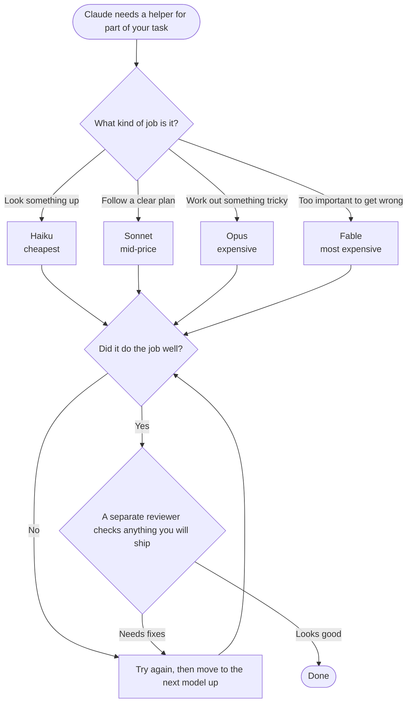

<p align="center">
  <picture>
    <source media="(prefers-color-scheme: dark)" srcset="assets/icon-dark.svg">
    
  </picture>
</p>

# efficient-claude

### Your Claude Code subagents are running on your most expensive model. Fix it in one command.

Every file search, log read and grep your subagents do is billed at your session's model price. On Opus, that is the same rate as your hardest design question, spent on work a model 40x cheaper handles fine. It drains your usage limit and your token budget for nothing.

efficient-claude makes Claude pick the right model for every subagent task, automatically.

- **Cheaper:** search and logs go to Haiku, edits to Sonnet, Opus and Fable only where they earn it.
- **Same quality:** it starts cheap, moves up one tier only when a cheaper model actually misses, and a stronger model that never saw the work reviews it before it ships.
- **Zero effort:** no new workflow. Work as usual; Claude states each route in one line.

```
Routing to scan/haiku: pure grep across the repo, spec fully determines output.
```

## Install (30 seconds)

```bash
claude plugin install model-router --marketplace thevrus/efficient-claude
```

Needs Claude Code 2.1.292+. Adds the skill, routing agents, and a hook that blocks any subagent call with no model set, so nothing slips through on the expensive default.

Codex, Cursor, OpenCode or other agents (skill only; there is no hook there, so routing is advice the agent can skip):

```bash
npx skills add thevrus/efficient-claude -g
```

## What you save

One session, 10 subagent tasks, list prices (illustrative math on an assumed mix, [not a benchmark](docs/comparison.md)):

| Task | Count | All on Opus | Routed |
| --- | --- | --- | --- |
| Search / logs | 6 | $2.16 | $0.05 (Haiku) |
| Edits from a plan | 3 | $1.08 | $0.54 (Sonnet) |
| Debug unknown cause | 1 | $0.60 | $0.60 (Opus) |
| **Total** | 10 | **$3.84** | **$1.19** (-69%) |

The hard task costs the same either way. The savings come from everything that never needed Opus.

Routing only changes what subagents cost. Your main session is billed as before, so if subagents are a small share of your spend, the saving is small too.

## Do you need it?

If you rarely spawn subagents, set `CLAUDE_CODE_SUBAGENT_MODEL=sonnet` and stop here. A fixed default gets you most of the benefit.

This plugin is the per-task version of that setting: Haiku where Sonnet is overkill, Opus or Fable where Sonnet is not enough, and a hook that blocks any subagent call with no model set. It pays off when you run a lot of subagents on an Opus or Fable session.

## How it routes

Claude hands parts of your task to helpers, called subagents. Each one can run on a cheap model or an expensive one. The plugin makes Claude match the model to the job, the same way you would not ask your most senior engineer to go find a file.



If Claude forgets to choose a model, the plugin stops the helper from starting until it does.

| Job | Model | Effort |
| --- | --- | --- |
| Search, logs, summaries | Haiku | low |
| Edits and tests from a clear plan | Sonnet | medium |
| Debugging, refactors, reviews | Opus | medium |
| Must be right the first time | Fable | medium |

Anything touching security or money never routes below Opus.

The table uses model aliases (`haiku`, `sonnet`, `opus`, `fable`). On the Anthropic API each alias moves to the newest model in its family when Claude Code updates; on Bedrock, Vertex and Foundry `sonnet` and `haiku` still point at older models. Prices and sources were last checked on 10 Nov 2026. The tier boundaries have not been re-tested since Sonnet 5.5, Haiku 5.5 and Fable 5.2 shipped; re-check them on your own tasks after a model release.

To route a specific task: `/efficient-claude refactor auth, use subagents for search and tests`

## Example

You ask for a feature the usual way. No command needed; the skill loads when Claude decides to delegate:

```
> add a CSV export to the reports page
```

Claude prints one line per subagent as it hands the work out (illustrative, not a recorded session):

```
Routing to scan/haiku: find where report rows are built and the existing PDF export code.
Routing to build/sonnet: add the CSV export button and handler following the PDF export, tests from the existing pattern.
Routing to reason/opus: read-only review of the diff by an agent that never saw the build.

Verdict: SHIP
```

Among the subagents, the search ran on Haiku, the edits on Sonnet, and only the review on Opus. If the review comes back FIX-FIRST, the fixes go back to the same Sonnet worker. The work moves to a model one tier up only if that worker still gets it wrong after three rounds of fixes.

Full rules: [SKILL.md](skills/efficient-claude/SKILL.md). Prices, benchmarks and sources: [rationale.md](skills/efficient-claude/references/rationale.md).

If it saves you tokens, a star helps others find it.

[](https://skills.sh/thevrus/efficient-claude)

MIT
